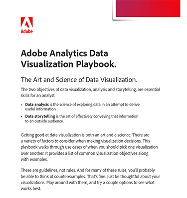

# Playbook di visualizzazione dati di Adobe Analytics

La visualizzazione dei dati è sia un’arte che una scienza, e richiede un’attenta considerazione di vari fattori. Per aiutarti a prendere alcune di queste decisioni, abbiamo creato il Playbook di Visualizzazione dati.

[Scarica](assets/adobe-analytics-data-visualization-playbook.pdf) il playbook di visualizzazione di Adobe Analytics

Che tu stia affrontando questioni di business comuni o che ti stia immergendo in analisi complesse, questo playbook completo esamina una serie di casi d’uso per dimostrare quando e come utilizzare in modo efficace diverse visualizzazioni.

## Autore

Questo documento è stato creato da David Geist,
consulente aziendale di dati e approfondimenti di Adobe.
